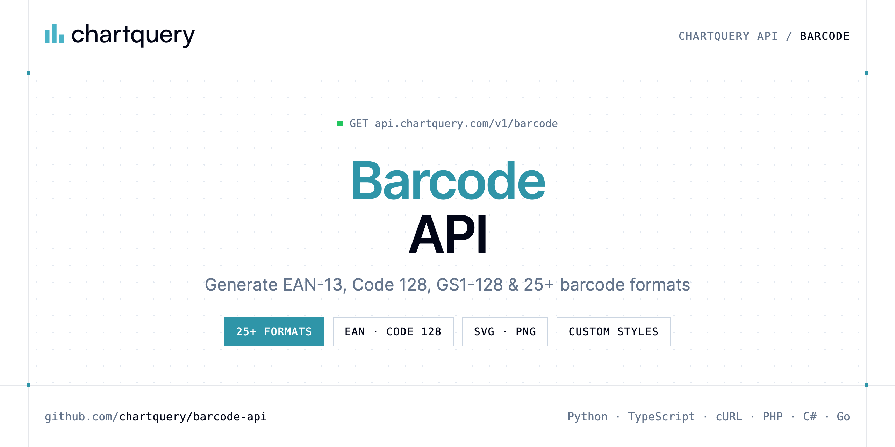

<p align="center">
  <a href="https://www.chartquery.com"></a>
</p>

# Barcode API

[](https://discord.gg/CFj3ph8aHU) [](https://app.chartquery.com/register) [](https://app.chartquery.com/openapi) [](LICENSE)

The **ChartQuery Barcode API** generates barcode images in 25+ formats — EAN-13, EAN-8, UPC-A, Code 128, ITF-14, GS1-128, postal codes and more — as SVG (default) or PNG.

- **Barcode API** — Generate a barcode image via GET.

Use it for retail packaging, shipping, inventory, invoices and labels.

| Endpoint | Request | Credits |
|---|---|---|
| [Barcode API](#barcode-api) | `GET /v1/barcode` | 3 |

## Table of contents

- [How it works](#how-it-works)
- [Barcode API](#barcode-api)
- [Code examples in other languages](#code-examples-in-other-languages)
- [Use cases](#use-cases)
- [Why ChartQuery?](#why-chartquery)
- [FAQ](#faq)
- [Official SDKs](#official-sdks)
- [Related repositories](#related-repositories)
- [Support](#support)

## How it works

1. **Create a ChartQuery account** and copy your API key from the [dashboard](https://app.chartquery.com/register).
2. **Call `https://api.chartquery.com`** with the header `x-api-key: YOUR_API_KEY`.
3. **Use the result** in your app — no infrastructure to run.

```bash
export CHARTQUERY_API_KEY="your-api-key"
pip install requests        # Python
# TypeScript: Node.js 18+ (native fetch), run with `npx tsx file.ts`
```

## Barcode API

Generate a barcode image via GET. Output: SVG (default) or PNG. Supports 25+ formats: EAN-13, Code 128, ITF-14, GS1-128, postal codes and more.

`GET https://api.chartquery.com/v1/barcode` · **3 credits per request** · [API reference](https://app.chartquery.com/openapi)

### Request parameters

| Parameter | In | Type | Required | Description |
|---|---|---|---|---|
| `data` | query | string | ✅ | The data to encode in the barcode. Examples by type: |
| `type` | query | string (`code128`, `code39`, `code39ext`, `code93`, `code93ext`, `ean13`) | — | Barcode format. Default: `code128`. |
| `height` | query | number | — | Bar height in pixels. Default: 80. Typical values: 50 (compact), 80 (standard), 100–120 (tall labels). Example: ?height=100 |
| `color` | query | string | — | Bar color as a CSS color string. Default: #000. Examples: ?color=%231e293b (dark slate), ?color=%230f172a (near black), ?color=%237c3aed (purple), ?color=%23dc2626 (red). Use %23 to URL-encode the # character. |
| `show_text` | query | boolean | — | Show human-readable text below the bars. Example: ?show_text=true. Combine with font_size and text_align for print labels. |
| `text_position` | query | string (`bottom`, `top`) | — | Position of the human-readable text label. Default: bottom. Example: ?text_position=top |
| `text_align` | query | string (`center`, `left`, `right`) | — | Horizontal alignment of the text label. Default: center. Example: ?text_align=left |
| `font_size` | query | number | — | Font size of the text label in pixels. Default: 14. Example: ?font_size=12 |
| `font_family` | query | string | — | Font family of the text label. Default: monospace. Examples: ?font_family=monospace, ?font_family=sans-serif, ?font_family=Arial |
| `bar_width` | query | number | — | Width multiplier per module (bar). Default: 2. Increase for wider, more scannable barcodes. Example: ?bar_width=3 |
| `bar_gap` | query | number | — | Extra horizontal spacing between bars in pixels. Default: 0. Example: ?bar_gap=1 |
| `background` | query | string | — | Background fill color. Default: #fff. Use transparent for no background. Example: ?background=%23f8fafc |
| `margin` | query | number | — | Uniform margin around the barcode in pixels. Default: 10. Overridden per side by margin_top/bottom/left/right. Example: ?margin=6 |
| `margin_top` | query | number | — | Top margin in pixels (overrides margin). Example: ?margin_top=4 |
| `margin_bottom` | query | number | — | Bottom margin in pixels (overrides margin). Example: ?margin_bottom=4 |
| `margin_left` | query | number | — | Left margin in pixels (overrides margin). Example: ?margin_left=8 |
| `margin_right` | query | number | — | Right margin in pixels (overrides margin). Example: ?margin_right=8 |
| `rotation` | query | number (`0`, `90`, `180`, `270`) | — | Rotate the barcode by 0, 90, 180 or 270 degrees. Default: 0. Use 90 or 270 for vertical label orientation. Example: ?rotation=90 |
| `bearer_bars` | query | boolean | — | Add horizontal bearer bars above and below the barcode. Required for ITF-14. Default: false. Example: ?bearer_bars=true |
| `unit` | query | string (`px`, `mm`, `in`, `cm`) | — | Measurement unit for dimensions. Default: px. Use mm, in or cm for print-ready output. Example: ?unit=mm |
| `aria_label` | query | string | — | Accessible label added as aria-label on the SVG element. Improves screen reader support. Example: ?aria_label=EAN-13+barcode+for+product+4006381333931 |
| `title` | query | string | — | SVG <title> element for tooltip and accessibility. Example: ?title=Product+Barcode |
| `desc` | query | string | — | SVG <desc> element for extended accessibility description. Example: ?desc=EAN-13+encoding+GTIN+for+Nivea+cream+75ml |
| `format` | query | string (`svg`, `png`) | — | Output format. Default: svg. Use png to get a raster image. SVG is lossless and scalable; PNG is pixel-based and suitable for email, PDF or messaging. Example: ?format=png |
| `share` | query | boolean (`false`, `true`) | — | Set share=true to persist the config and receive JSON instead of an image: { id, render_url, view_url, embed_url, expires_in }. Free plan: 3-day expiry with watermark. Paid plan: 6-month expiry, no branding. |

### Python example

```python
import os

import requests

API_KEY = os.environ["CHARTQUERY_API_KEY"]
HEADERS = {"x-api-key": API_KEY}

response = requests.get(
    "https://api.chartquery.com/v1/barcode",
    headers=HEADERS,
    params={
        "data": "HELLO-WORLD-2026",
    },
    timeout=120,
)
response.raise_for_status()

with open("barcode.svg", "wb") as f:
    f.write(response.content)
print("Saved barcode.svg", len(response.content), "bytes")
```

### TypeScript example

```typescript
import { writeFile } from "node:fs/promises";

const headers = { "x-api-key": process.env.CHARTQUERY_API_KEY!, "Content-Type": "application/json" };

const params = new URLSearchParams({
  "data": "HELLO-WORLD-2026",
});

const response = await fetch(`https://api.chartquery.com/v1/barcode?${params}`, { headers });
if (!response.ok) throw new Error(`HTTP ${response.status}: ${await response.text()}`);

await writeFile("barcode.svg", Buffer.from(await response.arrayBuffer()));
console.log("Saved barcode.svg");
```

### Output

The response body is the generated file (saved as `barcode.svg` in every example). Error responses are JSON with an explanatory message.

## Code examples in other languages

Ready-to-run examples live in [`examples/`](examples); each reads your key from `CHARTQUERY_API_KEY`.

| Language | `barcode` |
|---|---|
| cURL (Bash) | [barcode.sh](examples/curl/barcode.sh) |
| PHP | [barcode.php](examples/php/barcode.php) |
| C# | [Barcode.cs](examples/csharp/Barcode.cs) |
| Go | [barcode.go](examples/go/barcode.go) |
| Java | [BarcodeExample.java](examples/java/BarcodeExample.java) |
| Ruby | [barcode.rb](examples/ruby/barcode.rb) |
| Node.js | [barcode.mjs](examples/nodejs/barcode.mjs) |

## Use cases

- **Retail & packaging** — EAN/UPC barcodes for products.
- **Logistics** — Code 128 / GS1-128 for shipping and inventory.
- **Documents** — Barcodes on invoices and delivery notes.

## Why ChartQuery?

- **Images in one request** — the response body is the PNG/SVG/PDF, ready for emails, PDFs, dashboards, Slack or `` tags.
- **Charts, diagrams, QR codes, barcodes, labels** — Chart.js configs, 28 diagram languages (Mermaid, Graphviz, PlantUML, D2…), 25+ barcode formats.
- **AI generation** — describe a chart or diagram in plain English and get the rendered image.
- **No rendering infrastructure** — no headless browser, fonts or libraries to maintain.
- **Copy-paste examples** — Python and TypeScript in each README, 7 more languages in `examples/`.

## FAQ

### How do I authenticate?

Create an account on [ChartQuery](https://app.chartquery.com/register), copy your API key and send it in the `x-api-key` header of every request to `https://api.chartquery.com`.

### How much does a request cost?

Credits per call: `/v1/barcode` **3**. See [ChartQuery pricing](https://www.chartquery.com/pricing).

### What does the API return?

The response body is the file itself (image or document). Save it directly to disk or stream it to your storage — every example in this repository writes the file locally.

### Which languages are supported?

Any language that can make an HTTP request. This README shows Python and TypeScript; the [`examples/`](examples) folder contains cURL, PHP, C#, Go, Java, Ruby and Node.js.

## Official SDKs

Use ChartQuery from your own language with a typed client:

| SDK | Package | Install |
| --- | --- | --- |
| Node.js | [`@chartquery/sdk`](https://www.npmjs.com/package/@chartquery/sdk) | `npm install @chartquery/sdk` |
| Python | [`chartquery`](https://pypi.org/project/chartquery/) | `pip install chartquery` |
| Go | [`chartquery-go`](https://pkg.go.dev/github.com/chartquery/chartquery-go) | `go get github.com/chartquery/chartquery-go` |
| .NET | [`ChartQuery`](https://www.nuget.org/packages/ChartQuery) | `dotnet add package ChartQuery` |
| Ruby | [`chartquery`](https://rubygems.org/gems/chartquery) | `gem install chartquery` |
| PHP | [`chartquery/sdk`](https://packagist.org/packages/chartquery/sdk) | `composer require chartquery/sdk` |
| Java | [`chartquery-java`](https://github.com/chartquery/chartquery-java) | build from source, see its README |
| CLI | [`@chartquery/cli`](https://www.npmjs.com/package/@chartquery/cli) | `npm install -g @chartquery/cli` |
| MCP server | [`@chartquery/mcp`](https://www.npmjs.com/package/@chartquery/mcp) | `npx -y @chartquery/mcp` |

## Related repositories

- [Chart API](https://github.com/chartquery/chart-api)
- [Diagram API](https://github.com/chartquery/diagram-api)
- [QR Code API](https://github.com/chartquery/qr-code-api)
- [Thermal Label API](https://github.com/chartquery/thermal-label-api)
- [All ChartQuery repositories](https://github.com/chartquery)

## Support

- 💬 Join the [Discord](https://discord.gg/CFj3ph8aHU) to ask questions and share what you build.
- 📚 Read the [API reference](https://app.chartquery.com/openapi).
- 🔑 [Get your API key](https://app.chartquery.com/register).

---

<p align="center">
  <a href="https://www.chartquery.com">
    <picture>
      <source media="(prefers-color-scheme: dark)" srcset="images/logo-dark.svg">
      
    </picture>
  </a>
  <br>
  <sub>Built by <a href="https://www.chartquery.com">ChartQuery</a>. Examples are released under the MIT license.</sub>
</p>
